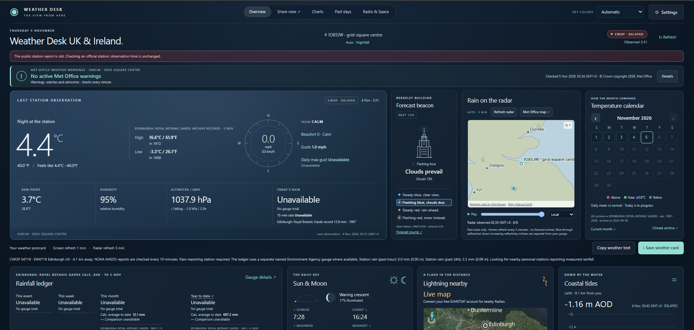

# Weather Desk UK & Ireland

A private, self-hosted weather dashboard for the United Kingdom and the Republic
of Ireland. It runs on your own computer, or in Docker on a home server. It
combines a personal weather station (or nearby public stations), forecasts,
official warnings, radar, climate comparisons, coastal tides, sky times,
satellite lightning and ham-radio space weather in one page you open in your
browser. No account, cloud service or subscription is needed to get started, and
everything you save stays on your machine.

**A collaboration between Shannon (KC1OHT) and Robert (KA6RTL).**

> **Edition:** UK & Ireland, build UK14. There is also a
> [US edition](https://github.com/geekmoto13/weather-desk). The two use different
> ports (8766 here, 8765 there), so you can run both side by side.
screenshot here: 

## What it shows

- **Current conditions** from a connected Ambient personal station, or
  automatically from the nearest usable public station. Nearby CWOP stations (via
  NOAA MADIS) must report measured rainfall, and a missing value is never shown
  as zero. In the Republic of Ireland, the automatic choice is the nearest usable
  Met Éireann station within 150 km. An official airport METAR is the fallback.
- **Forecast beacon**: a building-style light driven by a model forecast for the
  next 12 hours (steady blue clear, flashing blue clouds, steady red rain,
  flashing red snow). UK locations use the Open-Meteo / DWD ICON model, and Irish
  locations use Met Éireann's point forecast. It is not a Met Office forecast, and
  the model is named on screen.
- **Warnings**: the Met Office public warning strip for UK locations, with the
  original wording and clear marking when a feed is delayed or unavailable. Irish
  locations use that country's own sources.
- **Radar**: RainViewer past-radar map with a play slider, refreshed every five
  minutes. It shows past observations, not future rainfall.
- **Climate and history**: a temperature calendar and records compared with
  calculated 1991-2020 references from NOAA GHCN-Daily UK observations, the Met
  Office monthly station archive, and optional import of MIDAS Open daily data
  from CEDA.
- **Rainfall ledger**: public rainfall from a named Environment Agency gauge in
  England (a named Met Éireann gauge in Ireland), with gauge details. Figures are
  never combined across stations or filled with zeros.
- **Coastal tides**: a 24-hour chart from the nearest reporting Environment
  Agency tide gauge (and Irish coastal levels), in metres relative to Ordnance
  Datum Newlyn, with a link to Admiralty EasyTide for future tide times.
- **Sun and Moon** for your location. The card also shows the current twilight
  stage: daylight, civil, nautical or astronomical twilight, or night, with dawn
  or dusk.
- **Days since rain** in the rainfall heading, from your station's own last-rain
  time or from the named gauge's measured rainfall. Forecast and radar rain never
  count.
- **Beaufort wind force** from a ten-minute mean wind speed (no correction for
  sensor height). It shows unavailable when there is not enough wind data.
- **Lightning nearby** from EUMETSAT's Meteosat Lightning Imager. This is optional
  and uses a free EUMETSAT account's key and secret, entered in Settings.
- **Radio & Space**: NOAA SWPC space weather and KC2G propagation maps and circuit
  predictions for amateur radio.
- **Optional nearby personal stations** through your own Weather Underground API
  key.

Locations outside the UK and the Republic of Ireland are not supported in this
edition, and the app does not guess.

## Choose how to run it

| You have | Use |
| --- | --- |
| A Windows 10/11 PC (64-bit Intel/AMD) | [Windows](#windows) (nothing to install) |
| Python 3.10+ on Windows, macOS or Linux | [Installed Python](#macos--linux--raspberry-pi) |
| A server, NAS or VM running Docker | [Docker](#docker) |

## Windows

Python is included, so there is no pip, Node or extra software to install.

### 1. Get the files (pick one)

**Clone with Git**

```
git clone https://github.com/geekmoto13/weather-desk-uk.git
cd weather-desk-uk
```

**GitHub Desktop:** choose **File > Clone repository** and select this repo.

**Download a ZIP:** on the repository page click **Code > Download ZIP**, then
right-click the ZIP and choose **Extract All**. Always extract it to a normal
folder first. Do not run it from inside the ZIP.

### 2. Start it

Double-click **START-WEATHER-DESK-UK.bat**.

- The first run prepares the included Python and checks its files. This takes a
  moment, needs no internet access, and does not change your system PATH,
  registry or PowerShell policy.
- Your browser opens <http://127.0.0.1:8766/>.
- **Keep the console window open.** Close it, or press Ctrl+C, to stop.

If Windows SmartScreen warns about the `.bat` file, choose **More info > Run
anyway**. The launcher is a plain text script you can open and read.

### 3. First-time setup

In **Settings**, choose your location: a UK postcode, a town, or a 4-, 6- or
8-character Maidenhead grid. For the Republic of Ireland, search for your town
(for example Dublin, Cork or Galway). Eircode lookup is not included. Leave
readings on **Automatic**, or connect your Ambient station with its API key,
application key and optional MAC address, then click **Remember this station** to
save the connection locally.

### Other Windows launchers

| File | What it does |
| --- | --- |
| `START-WEATHER-DESK-UK.bat` | Runs with the bundled Python, this PC only |
| `START-WITH-INSTALLED-PYTHON.bat` | Uses your own Python 3.10+ instead |
| `START-WEATHER-DESK-UK-LAN.bat` | Bundled Python, **also open to your home network** |
| `START-WITH-INSTALLED-PYTHON-LAN.bat` | Installed Python, also open to your home network |
| `CHECK-WEATHER-DESK-RUNTIME.bat` | Verifies the bundled files and tests imports, TLS and SQLite. Keep its output if startup fails |

### Updating

- **Cloned with Git:** close the console, run `git pull`, and start it again.
  Your settings are kept, because the `private` folder is never part of the
  repository.
- **Downloaded a ZIP:** close the console and keep the old folder as a backup.
  Extract the new download into a new folder, then copy your old **private**
  folder into it to keep your connection, settings and history. Keep UK and US
  copies in separate folders.

## macOS / Linux / Raspberry Pi

Python 3.10+ is the only requirement (standard library only, no `pip install`):

```sh
python3 -I -X utf8 -B launch_weather.py --installed-python --open
```

Add `--lan` to let other devices on your network connect. Press Ctrl+C to stop.
The `start-weather-desk-uk.command` file does the same on macOS (you may need to
run `chmod +x start-weather-desk-uk.command` once).

## Docker

The image is built for both 64-bit Intel/AMD and 64-bit ARM (for example a
Raspberry Pi 4 or 5 on a 64-bit OS).

### Docker Compose

```yaml
services:
  weather-desk-uk:
    image: ghcr.io/geekmoto13/weather-desk-uk:latest
    container_name: weather-desk-uk
    ports:
      - "8766:8766"
    restart: unless-stopped
    volumes:
      - weather-desk-uk-data:/app/private

volumes:
  weather-desk-uk-data:
```

Save it as `docker-compose.yml`, run `docker compose up -d`, then open
`http://<host-ip>:8766/` from any device on your network.

### Single command

```
docker run -d --name weather-desk-uk -p 8766:8766 -v weather-desk-uk-data:/app/private --restart unless-stopped ghcr.io/geekmoto13/weather-desk-uk:latest
```

### Build it yourself

```
git clone https://github.com/geekmoto13/weather-desk-uk.git
cd weather-desk-uk
docker build -t weather-desk-uk .
```

### Updating the container

```
docker compose pull
docker compose up -d
```

Your settings, history and rain-since records live in the `weather-desk-uk-data`
volume and survive updates. Do not delete the volume, or run `docker compose down -v`, unless you
want to start over. In Portainer, leave "remove associated volumes" unticked.

### Docker notes

- To reach it by a hostname instead of an IP address, add this to the service
  (it replaces the default command):
  `command: ["python", "-X", "utf8", "server.py", "--lan", "--allow-host", "your-hostname"]`
- The container reports its own health. Docker shows it as **healthy** once
  the server is answering.

## Using it from other devices on your home network

By default the dashboard only listens on the computer it runs on. To open it from
a phone or tablet, start it with `--lan` or use one of the `-LAN` launchers. The
console prints the addresses to use, for example `http://192.168.1.50:8766/`.
The Docker image already runs in this mode.

**There is no password.** Anyone on your network who can reach the port can open
the dashboard and change its settings. Use it only on a network you trust, allow
it through your firewall on **private** networks only, and never forward port
8766 from your router to the internet.

Requests are accepted only for `localhost`, private-network IP addresses and
this computer's own name. To reach it by another name, add `--allow-host <name>`
(repeatable).

## Troubleshooting

**Windows: the page loads on the PC but not on a phone.** A firewall is blocking
port 8766. Allow it on private networks in Windows Defender Firewall. With
third-party security software (ESET, Norton and others), check its
blocked-connection log right after trying the phone, and allow the program or
port it names. The rule must match the program that is actually running, so a
different Python path needs its own rule.

**"Port 8766 is busy."** Another copy of the dashboard is already running. Close
it, or start with `--port 8767`. If the message names a different problem (for
example a permissions error), it is describing the real cause.

**Docker on Windows with WSL "mirrored" networking.** Published ports may work
on `localhost` but not from other devices. Allow inbound traffic to WSL in the
Hyper-V firewall, using PowerShell as Administrator:

```
Set-NetFirewallHyperVVMSetting -Name '{40E0AC32-46A5-438A-A0B2-2B479E8F2E90}' -Enabled True -DefaultInboundAction Allow
```

This opens all ports of WSL guests to your network, not only this app. Restart
Docker Desktop afterward (`wsl --shutdown`, then start it again). Alternatively,
switch WSL back to its default networking mode in `.wslconfig`.

**Docker: "Permission denied" on `/app/private`.** The data volume must be
writable by the container's user (UID 1000). A freshly created volume works;
remove an old root-owned volume and recreate it.

**Docker: no logs appear.** The published image sets `PYTHONUNBUFFERED=1`. If you
built your own image, add `ENV PYTHONUNBUFFERED=1` to the Dockerfile.

**Lightning shows a prompt instead of flashes.** Lightning needs a free EUMETSAT
account. Create a consumer key and secret at <https://api.eumetsat.int/api-key/>
and enter them in Settings. These are separate from your Ambient keys.

**Won't start at all.** Run **CHECK-WEATHER-DESK-RUNTIME.bat** and keep the full
output, or on installed Python run
`weather-desk.bat --installed-python --diagnose` in a terminal.

## Your data stays with you

Credentials, preferences, observations and caches are saved in the local
`private/` folder (the `weather-desk-uk-data` volume in Docker). On Windows,
remembered keys are encrypted for your account; elsewhere they are kept in an
owner-only file. **Never commit or share your `private/` folder.** **Forget
station** removes a saved connection. Weather is fetched from public feeds, and
saved history stays local. No MIDAS observations or CEDA account credentials are
bundled with the app.

## Data sources and licences

Forecast model data: Open-Meteo / DWD ICON (CC BY 4.0). Warnings and monthly
station archive: Met Office. Rainfall and tide gauges: Environment Agency. Irish
data: Met Éireann. Observations: NOAA MADIS/CWOP and the Aviation Weather Center
METAR service. Daily archive: NOAA NCEI GHCN-Daily. Radar: RainViewer, with
Natural Earth geography. Lightning: EUMETSAT. Space weather: NOAA SWPC and KC2G.
Ambient Weather and Weather Underground are used with your own keys.

Met Office MIDAS Open and Environment Agency data are used under the Open
Government Licence v3.0, and the repository includes the Met Office warnings
licence (`data/NSWWS-Open-Licence.pdf`) and Met Éireann data notes
(`data/met-eireann-data-notes.txt`). Contains Environment Agency information
(c) Environment Agency and/or database right. The MIT license below covers the
code only. The data keeps its own terms, and the full source list is in
[`DETAILS.md`](DETAILS.md).

## More details

The original project notes are in [`DETAILS.md`](DETAILS.md). They cover Irish
locations, the forecast beacon rhyme, public station rules, startup internals,
rainfall and climate calculations, MIDAS history, the tide chart, Radio & Space
and satellite lightning. Checks and their limits are in
[`VALIDATION.md`](VALIDATION.md).

## Credits and license

A collaboration between Shannon (KC1OHT) and Robert (KA6RTL).
Third-party notices are in [`third-party/`](third-party/).

Released under the MIT License. See [`LICENSE`](LICENSE).

## Support

Questions and bug reports are welcome as GitHub issues on this repository.
This is a hobby project maintained on a best-effort basis, so replies may
take a few days. Please include your edition, how you run it (Windows, Docker
or Python) and any error text. Never post your `private/` folder or API keys.
